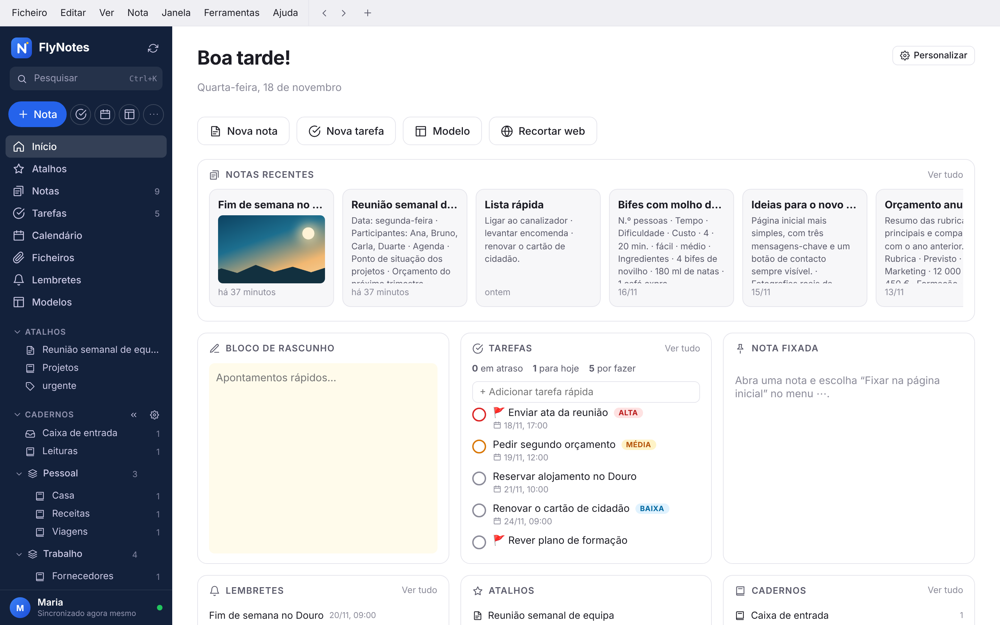
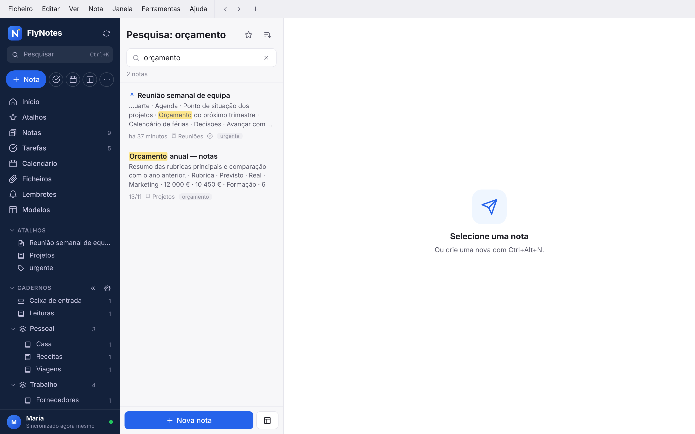
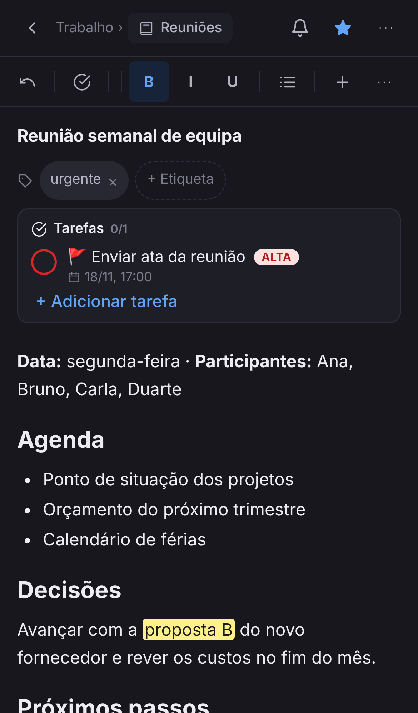

# FlyNotes

**[English](#english)** · **[Português](#o-que-faz)**

**As suas notas, tarefas e documentos em todo o lado — no computador e no telemóvel, mesmo sem internet.**

A FlyNotes é uma aplicação de notas pessoal, de código aberto e **totalmente gratuita**, inspirada no Evernote e pensada para uma só pessoa. Instala-se num servidor seu (também gratuito) e os dados ficam consigo: não há subscrições, versões pagas, publicidade nem contas de terceiros.


<p align="center">
  
  
  
  
</p>

## O que faz

- **Notas com editor completo** — títulos, listas, caixas de verificação, tabelas, realce, cores, código, ligações entre notas, datas, modelos prontos a usar.
- **Anexos dentro da nota** — imagens, PDF, vídeo, gravações de voz e ficheiros, com tamanho ajustável. O texto de PDF e de imagens digitalizadas fica pesquisável.
- **Organização** — cadernos agrupados em stacks, etiquetas, atalhos, notas fixadas, arrastar e largar (também no telemóvel).
- **Pesquisa** — instantânea, sem acentos, com operadores como `tag:`, `notebook:`, `intitle:`, `todo:`, `created:`.
- **Tarefas, lembretes e calendário** — com prazos, prioridades, repetição, notificações no telemóvel e ligação a calendários Google/Outlook/iCloud (leitura).
- **Funciona offline** — escreve sem rede e sincroniza quando a ligação voltar; edições em conflito ficam guardadas numa cópia.
- **Web Clipper** — extensão para Chrome e Edge que guarda artigos, páginas, seleções e capturas de ecrã.
- **Importação do Evernote** — ficheiros `.enex`, com anexos, etiquetas e datas. Exporta para ENEX, Markdown, HTML e PDF.
- **Segurança** — password, Face ID / impressão digital (passkeys), notas encriptadas com frase-passe, cópias de segurança diárias com restauro.
- **Aspeto** — modo claro e escuro, 13 cores, 4 estilos de barra lateral.

<details>
<summary><b>Mais capturas de ecrã</b></summary>

| Página inicial | Tarefas |
|---|---|
|  |  |

| Calendário | Pesquisa |
|---|---|
|  |  |

| Modo escuro | Modo escuro no telemóvel |
|---|---|
|  |  |

</details>

## Instalar

Há duas formas. **Se quer usar no telemóvel, escolha a opção A.**

| | A. Na nuvem (recomendado) | B. Só no computador |
|---|---|---|
| Funciona no telemóvel | Sim, em qualquer lugar | Só na mesma rede Wi-Fi, e sem instalar como app |
| Custo | Gratuito (planos gratuitos da Vercel e da Neon) | Gratuito |
| Precisa de | Conta no GitHub e na Vercel | Node.js instalado |
| Tempo | ~10 minutos | ~5 minutos |

### Opção A — Na nuvem, com um clique

[](https://vercel.com/new/clone?repository-url=https%3A%2F%2Fgithub.com%2Fdiogobsfsilva-glitch%2Fflynotes&project-name=flynotes&repository-name=flynotes&env=FLYNOTES_PASSWORD%2CSESSION_SECRET&envDescription=FLYNOTES_PASSWORD%3A%20a%20password%20para%20entrar%20na%20aplica%C3%A7%C3%A3o.%20SESSION_SECRET%3A%20um%20texto%20aleat%C3%B3rio%20longo%20%2840%20ou%20mais%20caracteres%29.&envLink=https%3A%2F%2Fgithub.com%2Fdiogobsfsilva-glitch%2Fflynotes%2Fblob%2Fmain%2Fdocs%2FINSTALAR.md&stores=%5B%7B%22type%22%3A%22integration%22%2C%22integrationSlug%22%3A%22neon%22%2C%22productSlug%22%3A%22neon%22%2C%22protocol%22%3A%22storage%22%7D%2C%7B%22type%22%3A%22blob%22%2C%22access%22%3A%22private%22%7D%5D)

1. Clique no botão acima e entre com a sua conta do GitHub (crie uma se não tiver).
2. A Vercel pede para criar a **base de dados (Neon)** e o **armazenamento de ficheiros (Blob)** — aceite os dois, no plano gratuito.
3. Preencha as duas variáveis:
   - `FLYNOTES_PASSWORD` — a password com que vai entrar na aplicação;
   - `SESSION_SECRET` — um texto aleatório longo (40 ou mais caracteres; pode bater no teclado ao acaso).
4. Clique em **Deploy**. Passado um minuto tem o seu endereço, do género `https://flynotes-xxxx.vercel.app`.

Depois instale no telemóvel e no computador como se fosse uma app — veja o [guia de instalação](docs/INSTALAR.md), que explica cada passo com mais detalhe, incluindo o iPhone, o Android, o Windows e o Mac.

### Opção B — Só no computador (Windows ou Mac)

1. Instale o [Node.js](https://nodejs.org) (versão LTS, 22 ou superior).
2. Descarregue este repositório: botão verde **Code → Download ZIP**, e extraia para uma pasta.
3. Abra a pasta e faça duplo clique em:
   - **Windows:** `iniciar.bat`
   - **Mac:** `iniciar.command`

Na primeira vez a instalação demora alguns minutos. No fim abre-se o navegador em `http://localhost:5173` e a janela preta mostra a **password criada para si**. Os dados ficam na pasta `.data`.

Quem preferir a linha de comandos:

```bash
npm install
npm start
```

## Documentação

- **[Guia de instalação passo a passo](docs/INSTALAR.md)** — nuvem, computador, telemóvel, Web Clipper, atualizações e resolução de problemas.
- [`.env.example`](.env.example) — todas as opções de configuração.

## Como está feita

- **Aplicação:** React, Vite e TipTap. Os dados vivem primeiro no dispositivo (IndexedDB) e sincronizam com o servidor.
- **Servidor:** funções Node em `api/` (Vercel) ou o servidor local em `server/dev.ts`.
- **Dados:** Postgres (Neon na nuvem; PGlite embutido na instalação local). Anexos no Vercel Blob privado ou em ficheiros locais.
- **Um utilizador por instalação.** Cada pessoa cria a sua própria instalação; não há partilha nem trabalho em equipa.

Para desenvolver: `npm run dev` (recarrega ao editar) e `npm run typecheck`.

## Privacidade e segurança

- Os dados ficam na base de dados e no armazenamento da **sua** conta. Ninguém além de si lhes acede.
- A aplicação está protegida por password; 5 tentativas erradas bloqueiam o acesso durante 15 minutos.
- Escolha uma password forte e nunca partilhe o ficheiro `.env` nem as variáveis da Vercel.
- As notas encriptadas usam AES-256; se esquecer a frase-passe, o conteúdo não pode ser recuperado.

## Apoiar o projeto

A FlyNotes é gratuita e vai continuar a ser. Se lhe for útil e quiser ajudar a manter o desenvolvimento, pode contribuir com o valor que entender — é totalmente opcional.

[](https://ko-fi.com/dfs78035)

## Licença e avisos

Distribuída sob a [licença MIT](LICENSE): pode usar, alterar e redistribuir livremente, sem garantias.

A FlyNotes é um projeto independente. **Não tem qualquer ligação à Evernote Corporation**; "Evernote" é uma marca do respetivo titular, referida apenas para indicar a compatibilidade de importação de ficheiros `.enex`. A extensão inclui o [Readability.js](extension/THIRD-PARTY.md) (licença Apache 2.0).

---

## English

**FlyNotes is a free, open-source personal note-taking app inspired by Evernote.** It runs on your computer and your phone, works offline, and keeps your data in an account that belongs to you.

**It costs nothing.** There is no subscription, no paid tier, no ads and no tracking. You host your own copy, and the free plans of Vercel (hosting) and Neon (database) are more than enough for personal use — or you can run it entirely on your own computer.

### What it does

- **Rich notes** — headings, lists, checklists, tables, highlights, colours, code blocks, links between notes, dates and 70+ ready-made templates.
- **Attachments inside the note** — images, PDFs, video, voice recordings and files, all resizable. Text inside PDFs and scanned images becomes searchable.
- **Organisation** — notebooks grouped into stacks, tags, shortcuts, pinned notes, drag and drop (on phones too).
- **Search** — instant, accent-insensitive, with Evernote-style operators such as `tag:`, `notebook:`, `intitle:`, `todo:` and `created:`.
- **Tasks, reminders and calendar** — due dates, priorities, recurrence, push notifications, and read-only Google / Outlook / iCloud calendar feeds.
- **Offline first** — write without a connection and sync later; conflicting edits are kept as a separate copy, never lost.
- **Web Clipper** — a Chrome and Edge extension that saves articles, full pages, selections, bookmarks and screenshots.
- **Evernote import** — `.enex` files with attachments, tags and dates. Exports to ENEX, Markdown, HTML and PDF.
- **Security** — password, Face ID / fingerprint (passkeys), per-note encryption, daily backups with restore.
- **Look and feel** — light and dark mode, 13 accent colours, 4 sidebar styles.

### Install

| | A. In the cloud (recommended) | B. On your computer only |
|---|---|---|
| Works on your phone | Yes, anywhere | Only on the same Wi-Fi, not installable as an app |
| Cost | Free | Free |
| You need | A GitHub and a Vercel account | Node.js 22 or later |

**A. In the cloud** — click the **Instalar na Vercel** button in the [Instalar](#instalar) section above. Accept the Neon database and the private Blob store (both on the free plan), set `FLYNOTES_PASSWORD` (the password you will sign in with) and `SESSION_SECRET` (any long random text), then press **Deploy**. Open your new address on your phone and choose *Add to Home Screen* (Safari on iPhone, Chrome on Android).

**B. On your computer** — install [Node.js](https://nodejs.org) (LTS), download this repository (**Code → Download ZIP**), extract it and double-click `iniciar.bat` (Windows) or `iniciar.command` (Mac). The first start prints a password generated for you. From a terminal: `npm install && npm start`.

The interface and the [step-by-step guide](docs/INSTALAR.md) are in Portuguese (Portugal); browser translation handles the guide well.

### Support the project

FlyNotes is free and will stay free. If you find it useful and would like to help keep development going, you can contribute any amount you like — entirely optional.

[](https://ko-fi.com/dfs78035)

### Good to know

- **One user per installation.** Everyone runs their own copy; there is no sharing or team features.
- **Your data stays yours** — it lives in your own database and storage, and nobody else can read it.
- **Licence:** [MIT](LICENSE) — use, modify and redistribute freely, with no warranty.
- **Not affiliated with Evernote.** FlyNotes is an independent project. "Evernote" is a trademark of its owner and is mentioned only to describe where the idea came from and the `.enex` import format.
