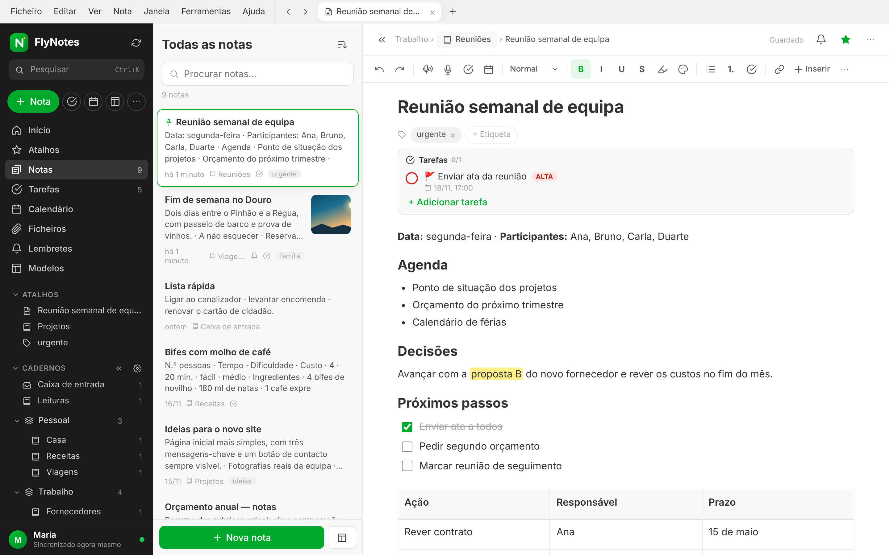
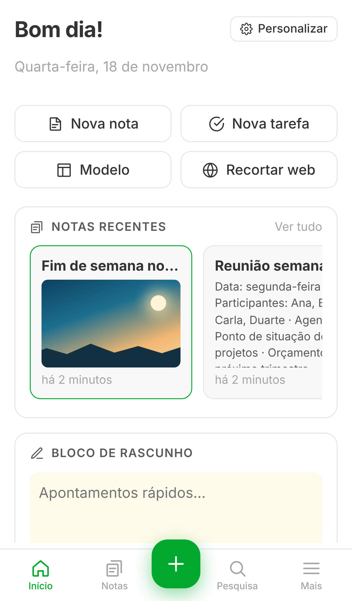
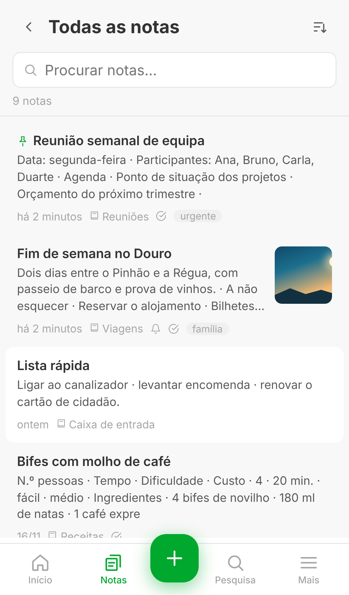
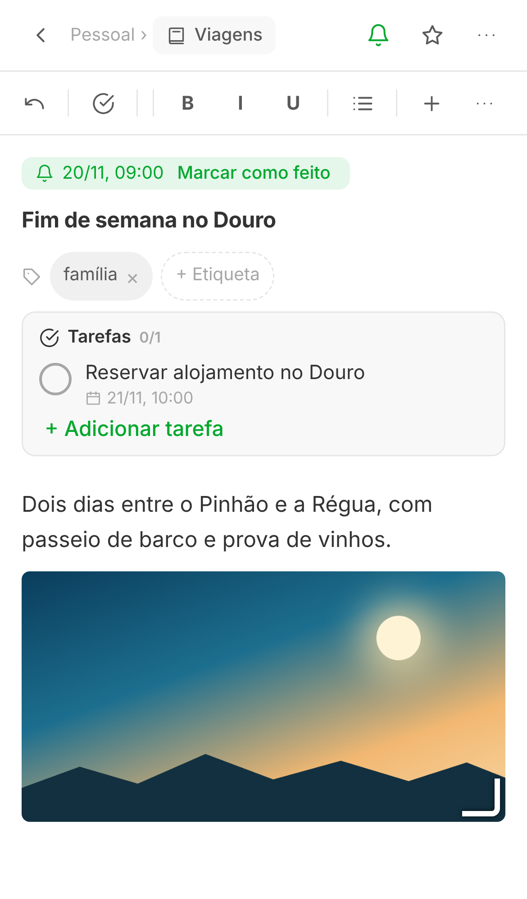
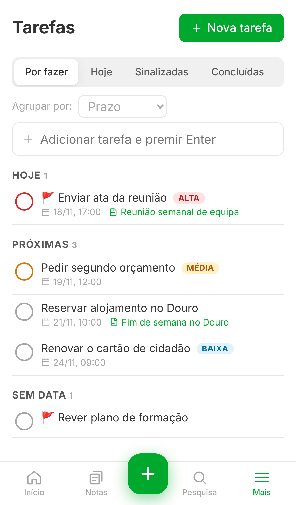
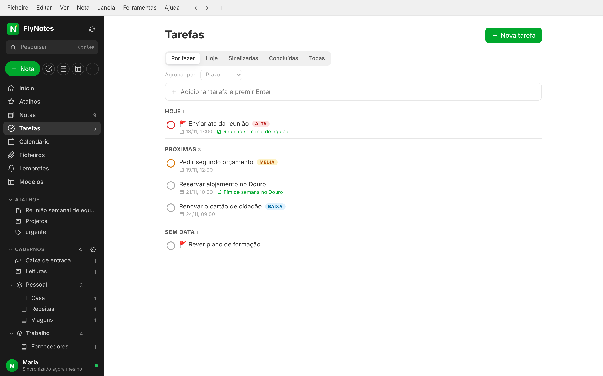
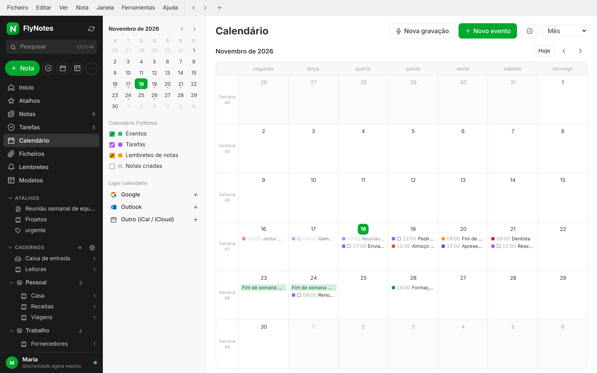
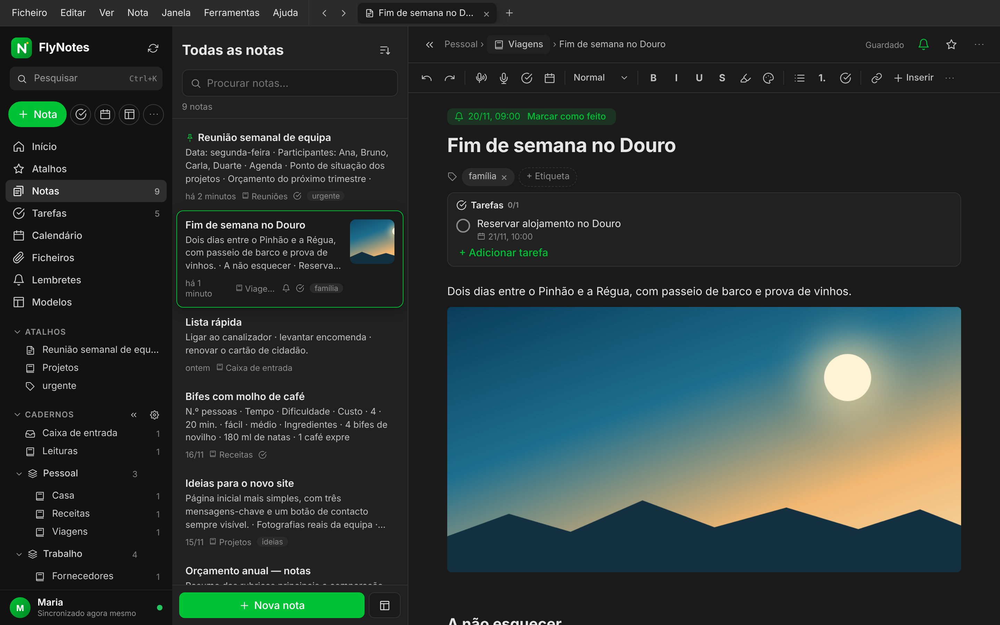

# FlyNotes

**As suas notas, tarefas e documentos em todo o lado — no computador e no telemóvel, mesmo sem internet.**

A FlyNotes é uma aplicação de notas pessoal, de código aberto, para uma só pessoa. Instala-se num servidor seu (gratuito) e os dados ficam consigo: não há contas de terceiros, publicidade nem subscrições.



<p align="center">
  
  
  
  
</p>

## O que faz

- **Notas com editor completo** — títulos, listas, caixas de verificação, tabelas, realce, cores, código, ligações entre notas, datas, modelos prontos a usar.
- **Anexos dentro da nota** — imagens, PDF, vídeo, gravações de voz e ficheiros, com tamanho ajustável. O texto de PDF e de imagens digitalizadas fica pesquisável.
- **Organização** — cadernos agrupados em stacks, etiquetas, atalhos, notas fixadas, arrastar e largar (também no telemóvel).
- **Pesquisa** — instantânea, sem acentos, com operadores como `tag:`, `notebook:`, `intitle:`, `todo:`, `created:`.
- **Tarefas, lembretes e calendário** — com prazos, prioridades, repetição, notificações no telemóvel e ligação a calendários Google/Outlook/iCloud (leitura).
- **Funciona offline** — escreve sem rede e sincroniza quando a ligação voltar; edições em conflito ficam guardadas numa cópia.
- **Web Clipper** — extensão para Chrome e Edge que guarda artigos, páginas, seleções e capturas de ecrã.
- **Importação do Evernote** — ficheiros `.enex`, com anexos, etiquetas e datas. Exporta para ENEX, Markdown, HTML e PDF.
- **Segurança** — password, Face ID / impressão digital (passkeys), notas encriptadas com frase-passe, cópias de segurança diárias com restauro.
- **Aspeto** — modo claro e escuro, 13 cores, 4 estilos de barra lateral.

<details>
<summary><b>Mais capturas de ecrã</b></summary>

| Página inicial | Tarefas |
|---|---|
|  |  |

| Calendário | Pesquisa |
|---|---|
|  |  |

| Modo escuro | Modo escuro no telemóvel |
|---|---|
|  |  |

</details>

## Instalar

Há duas formas. **Se quer usar no telemóvel, escolha a opção A.**

| | A. Na nuvem (recomendado) | B. Só no computador |
|---|---|---|
| Funciona no telemóvel | Sim, em qualquer lugar | Só na mesma rede Wi-Fi, e sem instalar como app |
| Custo | Gratuito (planos gratuitos da Vercel e da Neon) | Gratuito |
| Precisa de | Conta no GitHub e na Vercel | Node.js instalado |
| Tempo | ~10 minutos | ~5 minutos |

### Opção A — Na nuvem, com um clique

[](https://vercel.com/new/clone?repository-url=https%3A%2F%2Fgithub.com%2Fdiogobsfsilva-glitch%2Fflynotes&project-name=flynotes&repository-name=flynotes&env=FLYNOTES_PASSWORD%2CSESSION_SECRET&envDescription=FLYNOTES_PASSWORD%3A%20a%20password%20para%20entrar%20na%20aplica%C3%A7%C3%A3o.%20SESSION_SECRET%3A%20um%20texto%20aleat%C3%B3rio%20longo%20%2840%20ou%20mais%20caracteres%29.&envLink=https%3A%2F%2Fgithub.com%2Fdiogobsfsilva-glitch%2Fflynotes%2Fblob%2Fmain%2Fdocs%2FINSTALAR.md&stores=%5B%7B%22type%22%3A%22integration%22%2C%22integrationSlug%22%3A%22neon%22%2C%22productSlug%22%3A%22neon%22%2C%22protocol%22%3A%22storage%22%7D%2C%7B%22type%22%3A%22blob%22%2C%22access%22%3A%22private%22%7D%5D)

1. Clique no botão acima e entre com a sua conta do GitHub (crie uma se não tiver).
2. A Vercel pede para criar a **base de dados (Neon)** e o **armazenamento de ficheiros (Blob)** — aceite os dois, no plano gratuito.
3. Preencha as duas variáveis:
   - `FLYNOTES_PASSWORD` — a password com que vai entrar na aplicação;
   - `SESSION_SECRET` — um texto aleatório longo (40 ou mais caracteres; pode bater no teclado ao acaso).
4. Clique em **Deploy**. Passado um minuto tem o seu endereço, do género `https://flynotes-xxxx.vercel.app`.

Depois instale no telemóvel e no computador como se fosse uma app — veja o [guia de instalação](docs/INSTALAR.md), que explica cada passo com mais detalhe, incluindo o iPhone, o Android, o Windows e o Mac.

### Opção B — Só no computador (Windows ou Mac)

1. Instale o [Node.js](https://nodejs.org) (versão LTS, 22 ou superior).
2. Descarregue este repositório: botão verde **Code → Download ZIP**, e extraia para uma pasta.
3. Abra a pasta e faça duplo clique em:
   - **Windows:** `iniciar.bat`
   - **Mac:** `iniciar.command`

Na primeira vez a instalação demora alguns minutos. No fim abre-se o navegador em `http://localhost:5173` e a janela preta mostra a **password criada para si**. Os dados ficam na pasta `.data`.

Quem preferir a linha de comandos:

```bash
npm install
npm start
```

## Documentação

- **[Guia de instalação passo a passo](docs/INSTALAR.md)** — nuvem, computador, telemóvel, Web Clipper, atualizações e resolução de problemas.
- [`.env.example`](.env.example) — todas as opções de configuração.

## Como está feita

- **Aplicação:** React, Vite e TipTap. Os dados vivem primeiro no dispositivo (IndexedDB) e sincronizam com o servidor.
- **Servidor:** funções Node em `api/` (Vercel) ou o servidor local em `server/dev.ts`.
- **Dados:** Postgres (Neon na nuvem; PGlite embutido na instalação local). Anexos no Vercel Blob privado ou em ficheiros locais.
- **Um utilizador por instalação.** Cada pessoa cria a sua própria instalação; não há partilha nem trabalho em equipa.

Para desenvolver: `npm run dev` (recarrega ao editar) e `npm run typecheck`.

## Privacidade e segurança

- Os dados ficam na base de dados e no armazenamento da **sua** conta. Ninguém além de si lhes acede.
- A aplicação está protegida por password; 5 tentativas erradas bloqueiam o acesso durante 15 minutos.
- Escolha uma password forte e nunca partilhe o ficheiro `.env` nem as variáveis da Vercel.
- As notas encriptadas usam AES-256; se esquecer a frase-passe, o conteúdo não pode ser recuperado.

## Licença e avisos

Distribuída sob a [licença MIT](LICENSE): pode usar, alterar e redistribuir livremente, sem garantias.

A FlyNotes é um projeto independente. **Não tem qualquer ligação à Evernote Corporation**; "Evernote" é uma marca do respetivo titular, referida apenas para indicar a compatibilidade de importação de ficheiros `.enex`. A extensão inclui o [Readability.js](extension/THIRD-PARTY.md) (licença Apache 2.0).

---

**English:** FlyNotes is an open-source, single-user, local-first notes app (notes, tasks, calendar, attachments, offline sync, web clipper, ENEX import). The interface and documentation are in Portuguese. To install, use the Vercel button above (free tiers of Vercel + Neon), or run `npm install && npm start` locally with Node.js 22+.
